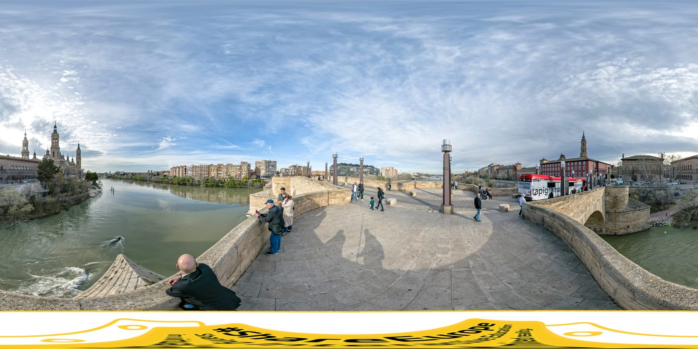

# HVS-3B Search Studio

A web studio for watching and replaying **HVS-3B** humanoid search episodes.
The model stands inside a 360° panorama, sees only a narrow perspective view,
and decides how to turn its head until the target is centred.

The app is **replay-first**: every episode is saved as JSON plus step images, so
the interface works with no GPU and no backend. Live inference against the real
models is an optional extra that runs on Kaggle.



---

## Status

| Area | State |
| --- | --- |
| Frontend Play page (animated panorama, trace, replay) | Working |
| Bundled demo run (no GPU, no backend) | Working |
| FastAPI contract API (episodes, SSE, panoramas, compare) | Working |
| Episode persistence and replay files | Working |
| Transformers / OpenAI-compatible / Mock adapters | Working |
| Compare and Bench pages | Placeholder UI |
| Live Play wiring to the contract API | Not finished — see [Known limitations](#known-limitations) |

The demo is the supported path today. The backend and the model loop are real
and tested; the Play page still streams from an older prototype `POST /api/run`
shape that this backend does not expose.

---

## What it does

HVS-3B is a 3B vision-language model (a Qwen2.5-VL-3B fine-tune) trained for two
tasks inside equirectangular panoramas:

- **HOS** — object search. Success when the submitted view is within **30° yaw**
  and **20° pitch** of the target.
- **HPS** — path/heading search. Success when the submitted heading is within
  **10° yaw** of the target (azimuth only).

At each step the model receives the current 448×448 perspective view, the
instruction, and the last two turns of context. It answers with reasoning in
`<think>` and one action in `<answer>`:

- `rotate(dyaw, dpitch)` — turn relative to the current pose.
- `submit(yaw, pitch)` — finish at an absolute pose.

The backend renders the view, calls the model, parses the action, updates the
pose, saves the step image, and repeats until the model submits or the step
budget runs out.

---

## Architecture

```text
Browser (React + Vite)                         Kaggle notebook (T4 x2)
┌──────────────────────────┐    HTTPS + SSE   ┌─────────────────────────────┐
│ Play / Compare / Bench   │ ◀──────────────▶ │ FastAPI app                 │
│ Settings (localStorage)  │   cloudflared    │  ├─ hvs-3b-sft  (cuda:0)    │
│ Demo stream (no backend) │    tunnel        │  └─ hvs-3b      (cuda:1)    │
└──────────────────────────┘                  │ runs/  → episode.json + JPEG│
                                              └─────────────────────────────┘
```

Key decisions:

1. **Contract first.** `docs/CONTRACT.md` defines the run file and the REST/SSE
   API. Both sides are built against it.
2. **Replay first, live second.** Saved runs replay with no GPU, so the demo
   survives a dead Kaggle session.
3. **The server owns the loop.** The browser never sees model URLs or weights.
4. **Models are injected.** `create_app(adapters, ...)` receives models that are
   already in memory. Nothing is loaded twice.
5. **One adapter interface.** `generate(messages, images) -> str`, implemented
   by `TransformersAdapter`, `OpenAICompatAdapter`, and `MockAdapter`.
6. **Never fabricate the prompt.** If `backend/prompts/official.txt` is missing
   or empty, a live episode fails with a clear error instead of using a
   made-up prompt.

---

## Repository layout

```text
.
├── backend/                  FastAPI service and episode loop
│   ├── hvs_backend/
│   │   ├── adapters/         Transformers, OpenAI-compatible, Mock
│   │   ├── agent.py          Async episode runner (SSE events)
│   │   ├── api.py            REST + SSE surface
│   │   ├── geometry.py       Yaw wrap, pitch clamp, success checks
│   │   ├── main.py           Local mock-model dev server (no GPU)
│   │   ├── panorama.py       Perspective view rendering
│   │   ├── parser.py         Tolerant <think>/<answer> parser
│   │   ├── prompting.py      Official prompt loading and messages
│   │   ├── serve.py          Notebook launcher + cloudflared tunnel
│   │   └── store.py          Atomic run-file persistence
│   ├── prompts/official.txt  Required prompt (never auto-generated)
│   └── tests/                138 pytest tests
├── frontend/                 React 18 + TypeScript + Vite
│   ├── public/demo-assets/   Bundled 360° panorama and target view
│   └── src/
│       ├── api/              SSE client, demo stream, typed contract
│       ├── components/       Panorama stage, trace, result banner
│       ├── pages/            Play, Compare, Bench, Settings
│       ├── settings/         Versioned localStorage settings
│       └── state/            Episode reducer and playback motion
├── kaggle/                   Notebook helper and cell-by-cell guide
├── docs/
│   ├── CONTRACT.md           Run-file and API contract
│   └── design-brief.docx     Original frontend/backend plan
├── AGENTS.md                 Repo rules and architecture decisions
├── Makefile                  install / check / dev entry points
└── .env.example              Environment variable template
```

---

## Quick start

### Prerequisites

- **Python 3.10+** (3.12 recommended)
- **Node.js 18+** (20 LTS recommended) and npm
- No GPU needed for the demo or the test suite

### Install

```bash
git clone https://github.com/It2works/HVS-3B-Search-Studio.git
cd HVS-3B-Search-Studio
make install
```

`make install` creates `backend/.venv`, installs the backend in editable mode,
and runs `npm install` in `frontend/`.

### Run the demo (no backend)

```bash
make dev-frontend
```

Open <http://localhost:5173>. Demo mode is on by default: the page plays a
scripted episode against the bundled panorama immediately.

To start the API too:

```bash
HVS_API_KEY=dev-key make dev-backend
# in another terminal
make dev-frontend
```

Check it is up:

```bash
curl -H "X-API-Key: dev-key" http://localhost:8000/api/health
```

The local dev server uses `MockAdapter`, a deterministic scripted model, so it
needs no GPU. It exists to exercise the API and the frontend shell.

### Configuration

| Variable | Default | Used by |
| --- | --- | --- |
| `HVS_API_KEY` | — (required) | Backend; every `/api/*` request |
| `FRONTEND_ORIGIN` | `http://localhost:5173` | Backend CORS allow-list |
| `HVS_RUNS_DIR` | `./runs` | Backend episode storage |

Copy `.env.example` as a reference. The backend does not load `.env` files
automatically; export the variables or prefix the command.

In the app, **Settings** stores the backend URL, API key, model defaults, and
the demo-mode toggle in `localStorage`. Use **Settings → Reset** to clear them.

---

## How an episode runs

1. The client uploads a panorama (`POST /api/panoramas`, JPEG/PNG, ≤ 40 MB,
   downscaled to 4096 px wide).
2. `POST /api/episodes` validates the task/model, loads the panorama, and
   starts an async episode.
3. For each step the backend renders a 448×448 view at the current pose,
   builds messages from the official prompt plus the last two turns, and calls
   the adapter.
4. The parser extracts the first `<think>` block and the first valid
   `rotate`/`submit` action. Malformed output becomes a failed step, never a
   crashed episode.
5. The pose is updated (yaw wrapped to `[0, 360)`, pitch clamped to
   `[-90, 90]`), the step image is written, and an SSE event is published.
6. The episode ends on `submit`, `max_steps`, `error`, or cancellation. The run
   file and images are written atomically to `runs/<episode_id>/`.

Replay is the same event stream reconstructed from the stored run file, so the
frontend needs no model to show an episode.

---

## API overview

All routes live under `/api` and require `X-API-Key`. The SSE route also
accepts `?api_key=` because `EventSource` cannot set headers.

| Method | Route | Purpose |
| --- | --- | --- |
| `GET` | `/health` | Loaded models and claimed GPUs |
| `POST` | `/panoramas` | Upload a panorama (multipart) |
| `GET` | `/panoramas/{id}/image` | Fetch a stored panorama |
| `POST` | `/episodes` | Start an episode |
| `GET` | `/episodes` | List episode summaries |
| `GET` | `/episodes/{id}` | Fetch the run file |
| `GET` | `/episodes/{id}/events` | SSE: live or replayed events |
| `POST` | `/episodes/{id}/cancel` | Cancel a running episode |
| `GET` | `/episodes/{id}/steps/{t}/image` | The JPEG the model saw |
| `POST` | `/compare` | Start two episodes on one panorama |

SSE event types: `episode_started`, `step_started`, `step_completed`,
`episode_finished`, `error`. The full payloads are in
[`docs/CONTRACT.md`](docs/CONTRACT.md).

`/api/bench/*` is reserved in the contract but not implemented.

---

## Kaggle live mode

The real models run in a Kaggle notebook with **two T4 GPUs**:

- `hvs-3b-sft` → `humanoid-vstar/HVS-3B-sft-only` on `cuda:0`
- `hvs-3b` → `humanoid-vstar/HVS-3B` on `cuda:1`

The notebook loads the models once, wraps them with `TransformersAdapter`, and
calls `create_app(adapters, runs_dir, api_key, frontend_origin)`. A
`cloudflared` quick tunnel exposes the API to the browser.

See [`kaggle/NOTEBOOK_CELLS.md`](kaggle/NOTEBOOK_CELLS.md) for the cell-by-cell
recipe and [`kaggle/run_studio.py`](kaggle/run_studio.py) for the helper.

Notes:

- Put `HVS_API_KEY` in **Kaggle Secrets**, never in a cell or the repo.
- A GPU session ends after 12 hours (often earlier when idle), and the tunnel
  URL changes every session. Re-run the cells and update the backend URL in
  **Settings**.
- Export `runs/` before the session dies. Those folders replay locally forever.
- The backend refuses to start a live episode if
  `backend/prompts/official.txt` is missing or empty.

---

## Testing and linting

```bash
make check
```

This runs, in order:

- `ruff check` on the backend
- `pytest` on the backend (138 tests, no GPU)
- `eslint` on the frontend
- `tsc --noEmit` (TypeScript strict)
- `vitest run` (65 tests)

Individual commands:

```bash
cd backend && .venv/bin/python -m pytest -q
cd frontend && npm run lint
cd frontend && npm run test
cd frontend && npm run build
```

Angle math, parsing, geometry, storage, the API, the Kaggle helper, playback,
and the demo stream all have dedicated tests, including wrap-around at 0°/360°,
pitch clamping, and malformed model output.

---

## Known limitations

- **Live Play wiring.** The Play page posts to a prototype `POST /api/run` and
  consumes inline `image_url` values. The backend implements the contract API
  (`POST /api/episodes` + `GET /api/episodes/{id}/events`) instead. Demo mode
  is unaffected. To finish live mode, either add the compatibility route or
  move `useEpisodeStream` onto the contract endpoints.
- **Compare and Bench are placeholders.** `/api/compare` exists, but the
  Compare page does not call it; `/api/bench/*` is not implemented.
- **The API is a prototype.** The key lives in browser `localStorage` and is
  sent to the backend. It is suitable for a Kaggle tunnel demo, not for an
  untrusted public deployment.
- **The demo assets are illustrative.** `panorama.jpg` and `final_view.jpg` are
  a bundled scene, not a benchmark sample.

---

## Models and data

- Models: [`humanoid-vstar/HVS-3B`](https://huggingface.co/humanoid-vstar/HVS-3B)
  and [`humanoid-vstar/HVS-3B-sft-only`](https://huggingface.co/humanoid-vstar/HVS-3B-sft-only)
- Benchmarks: `humanoid-vstar/hstar_bench` (and `hstar_bench_png`)
- The models are Qwen2.5-VL-3B fine-tunes; load them in fp16/BF16 and cap image
  tokens at 448×448.

The official prompt is required and is read verbatim from
`backend/prompts/official.txt`. The backend has no fallback prompt by design.

---

## Contributing

Read [`AGENTS.md`](AGENTS.md) before changing the architecture. The short
version: contract first, small commits, tests for every module, no secrets, and
never invent the prompt.

## License

No license has been added yet. Add one before distributing or accepting
external contributions.
