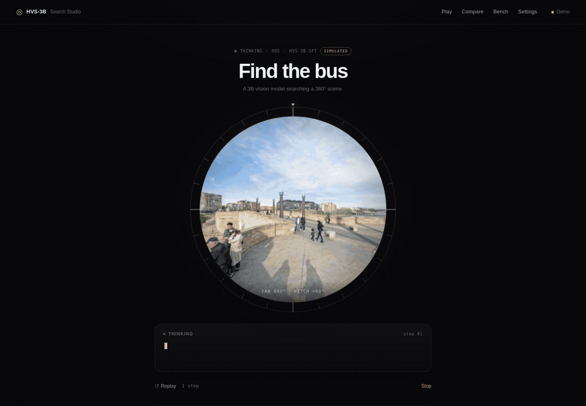
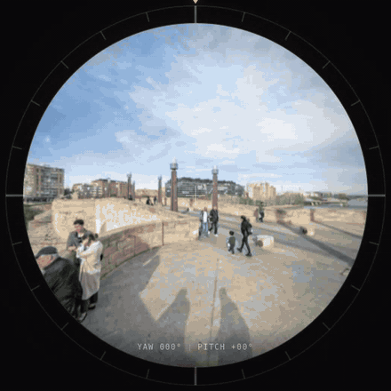
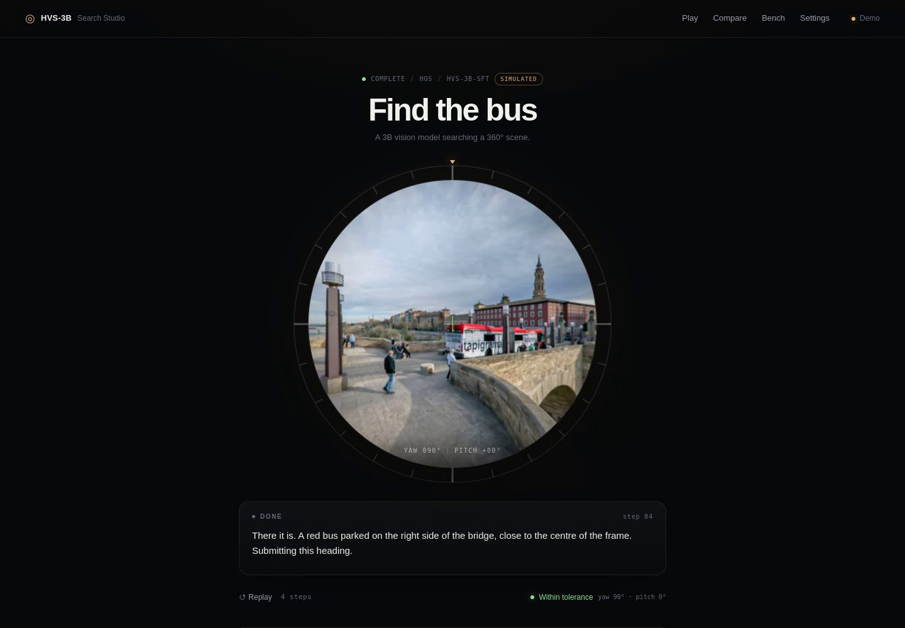

# HVS-3B Search Studio

**A small web app for watching a 3B vision model search a 360° scene.**



HVS-3B is a fine-tune of Qwen2.5-VL-3B for embodied search. It stands in the
middle of an equirectangular panorama, sees only a narrow perspective crop, and
has to decide how to turn its head. This studio makes that loop visible: the
view, the model's reasoning, the pose, and the final answer, step by step.

I built it around two ideas. The browser should be able to replay a finished
episode with no GPU and no backend. The server should own the model loop, so the
frontend never touches weights or model-provider keys.

The GIFs and screenshots below are screen recordings of the app running locally,
not mockups.

## What you're looking at

The GIF above is the bundled demo. It runs entirely in the browser against a
panorama of the Puente de Piedra in Zaragoza. The model is scripted, but the
playback is the same code path a real run uses: a thought is typed out, the head
turns, the next view is rendered, and the episode ends with a verdict.

The real model is not bundled. Running it needs a GPU and the weights; there is
a section on that below.

## The two tasks

HVS-3B is evaluated on two tasks:

- **HOS (object search).** Turn until the target object is centred, then submit.
  A submission counts if it is within 30° yaw and 20° pitch of the ground truth.
- **HPS (path search).** Turn toward the direction you would walk. A submission
  counts if it is within 10° yaw. Pitch is ignored.

Yaw is `[0, 360)` clockwise and pitch is `[-90, 90]`, positive up. The model
answers with a thought in `<think>` and one action in `<answer>`: either
`rotate(dyaw, dpitch)` or `submit(yaw, pitch)`.

## How an episode runs



1. The browser uploads a panorama. The server caps it at 4096 px wide and stores
   it as JPEG.
2. For each step, the server renders a 448×448 perspective view at the current
   pose.
3. It builds a chat prompt from the official system prompt, the instruction, and
   the last two turns, then calls the model adapter.
4. The parser pulls out the first thought and the first valid action. Malformed
   output marks the step as failed instead of crashing the episode.
5. The pose is updated, the step image is saved, and an SSE event goes out.
6. The episode stops on `submit`, the step limit, an error, or cancellation.
   Everything is written to `runs/<episode_id>/`.

A completed run looks like this:



## Running it

You need Python 3.10+ and Node 18+. No GPU for the demo or the tests.

```bash
git clone https://github.com/It2works/HVS-3B-Search-Studio.git
cd HVS-3B-Search-Studio
make install
make dev-frontend
```

Open <http://localhost:5173>. Demo mode is on by default, so the run starts on
its own.

If you want the API too, the repo includes a local server that uses a scripted
mock model:

```bash
HVS_API_KEY=dev-key make dev-backend
curl -H "X-API-Key: dev-key" http://localhost:8000/api/health
```

The local server is only for exercising the API. It does not load HVS-3B.

### Configuration

The backend reads `HVS_API_KEY` (required), `FRONTEND_ORIGIN` (CORS, default
`http://localhost:5173`), and optionally `HVS_RUNS_DIR` (default `./runs`). The
frontend keeps its backend URL, key, and defaults in `localStorage`; you can
change them on the Settings page.

## The backend

The FastAPI app is built around one adapter interface:

```python
generate(messages, images) -> str
```

There are three implementations. `TransformersAdapter` wraps a model and
processor that are already loaded in memory. `OpenAICompatAdapter` talks to a
vLLM or other OpenAI-compatible endpoint. `MockAdapter` replays a fixed script
and is what the local server uses.

The notebook owns model loading and passes the adapters into `create_app(...)`,
so the backend never downloads weights or reads a key from disk. Episode files
are written atomically: `episode.json`, `panorama.jpg`, and `step_<t>.jpg`. The
same SSE stream is used for replay, so the frontend can show a saved run without
a model.

The contract is in [`docs/CONTRACT.md`](docs/CONTRACT.md). The main routes are
`POST /api/panoramas`, `POST /api/episodes`, `GET /api/episodes/{id}/events`,
`GET /api/episodes/{id}`, and `POST /api/compare`. Every route except the SSE
query-string variant expects `X-API-Key`.

## Running the real models

The models are `humanoid-vstar/HVS-3B` and `humanoid-vstar/HVS-3B-sft-only`.
They are Qwen2.5-VL-3B fine-tunes. The reference setup is a Kaggle notebook with
two T4s, one model per GPU, and a `cloudflared` quick tunnel.

[`kaggle/NOTEBOOK_CELLS.md`](kaggle/NOTEBOOK_CELLS.md) has the cell-by-cell
recipe. [`kaggle/run_studio.py`](kaggle/run_studio.py) is the helper that starts
uvicorn, opens the tunnel, and prints the public URL. Put `HVS_API_KEY` in
Kaggle Secrets; don't paste it into a cell.

Two things to know: a GPU session lasts 12 hours at most, and the tunnel URL
changes every session. Export `runs/` before the session ends. The saved folders
replay locally with no GPU.

## What works, and what doesn't yet

The Play page, the demo stream, the episode loop, the parser, the geometry, the
storage, the adapters, and the contract API are implemented and tested. The
bundled demo is the most reliable way to see the app.

The rough edges:

- The Play page still posts to an older `POST /api/run` prototype stream. The
  backend implements the contract routes (`POST /api/episodes` plus
  `GET /api/episodes/{id}/events`), but I haven't connected the two yet. Demo
  mode is unaffected.
- Compare and Bench are placeholder pages. `/api/compare` exists;
  `/api/bench/*` does not.
- The API key lives in browser `localStorage`. That is fine for a Kaggle tunnel
  demo, not for a public deployment.
- The bundled panorama is a demo scene, not a benchmark sample.

I would rather leave these visible than pretend the whole thing is finished.

## Tests

```bash
make check
```

This runs ruff and pytest on the backend, then eslint, `tsc --noEmit`, and
vitest on the frontend. At the moment that is 138 backend tests and 66 frontend
tests. The angle math, parser, geometry, storage, API, Kaggle helper, playback,
and demo stream all have their own cases, including yaw wrap-around and
malformed model output.

## A few design notes

**Replay first.** A saved episode is just JSON and JPEGs, so the demo survives a
dead Kaggle session and a reviewer can open it without a GPU.

**The server owns the loop.** The browser never sees model URLs, weights, or the
key used for the model provider.

**The prompt is not generated.** `backend/prompts/official.txt` has to exist and
be non-empty, or a live episode fails with a clear error. I didn't want a
fallback prompt quietly changing the experiment.

**Models are injected.** The notebook passes in objects that are already in
memory. The backend does not load a second copy.

## Models and data

- [`humanoid-vstar/HVS-3B`](https://huggingface.co/humanoid-vstar/HVS-3B)
- [`humanoid-vstar/HVS-3B-sft-only`](https://huggingface.co/humanoid-vstar/HVS-3B-sft-only)
- Benchmarks: `humanoid-vstar/hstar_bench`, `humanoid-vstar/hstar_bench_png`

The original project plan is in [`docs/design-brief.docx`](docs/design-brief.docx).
The repo rules I worked against are in [`AGENTS.md`](AGENTS.md).

## What I'd do next

The first thing is to connect the Play page to the contract endpoints so live
mode works end to end. After that, the Compare page and the bench routes.

## License

MIT. See [LICENSE](LICENSE).
